# 📚 Concurso+ | Sistema de Gerenciamento de Estudos para Concursos Públicos


**O Concurso+ nasceu de um problema real identificado com amigos que estudam para concursos públicos:** a dificuldade de encontrar um aplicativo que reunisse, de forma prática, o registro das sessões de estudo, o planejamento de revisões, o acompanhamento das horas estudadas e a análise do desempenho em questões.

Antes de desenvolver a solução, realizei um **levantamento e análise de requisitos com esses estudantes**, buscando entender suas rotinas, dificuldades e necessidades. A partir dessas conversas, organizei e documentei os requisitos funcionais e, somente depois, iniciei a implementação do sistema.

O resultado é uma aplicação para **transformar registros de estudo em informações úteis para a preparação**: visualizar a constância, identificar os assuntos com mais erros, acompanhar as revisões pendentes e redistribuir esforços ao longo do tempo. A proposta é apoiar decisões de estudo mais conscientes, sem prometer ou garantir aprovação. Também permite modo Desktop ou Mobile, bem como modo claro ou escuro, objetivando melhor experiência do usuário.

> **Privacidade e funcionamento local:** nesta versão, os dados são mantidos na própria instalação do aplicativo, sem envio a serviços externos ou necessidade de criar uma conta. Cada cópia possui seu arquivo de informações. O projeto já conta com **persistência local em arquivo**, e versões futuras poderão incluir uma alternativa de persistência mais estruturada ou sincronização opcional, ainda a definir.

---

## 📱 Visualização do sistema — Desktop e Mobile

As capturas abaixo foram produzidas a partir da **versão mais recente do Concurso+**, com **dados fictícios**. O mesmo sistema é apresentado em telas desktop e mobile, utilizando o tema escuro como referência visual. O aplicativo também oferece tema claro.

## 1. Registros
### 1.1. Visão geral dos registros

O painel inicial reúne sessões, horas estudadas, questões respondidas, acertos, erros e taxa de aproveitamento. Filtros por grupo e banca permitem explorar o histórico sem perder a visão global. Cada registro pode incluir grupo, conteúdo, banca, data, tipo de atividade (estudo ou revisão), duração, número de questões, acertos e anotações. Também é possível agendar lembretes para revisões futuras.

### 1.2. Planejamento e acompanhamento de revisões

Revisões realizadas e lembretes futuros são apresentados separadamente. Concluir um lembrete elimina a pendência, mas não cria automaticamente uma sessão realizada nem altera os indicadores de desempenho.

| Desktop | Mobile |
|:---:|:---:|
| [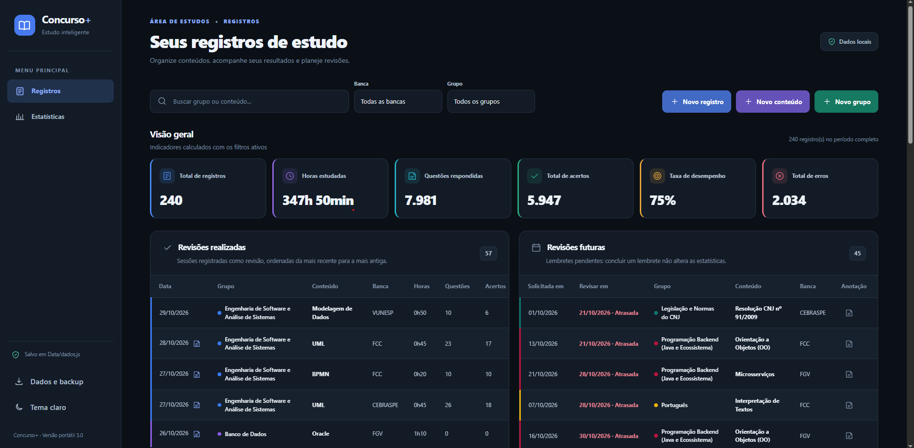](images/visao_geral_desktop.png) | [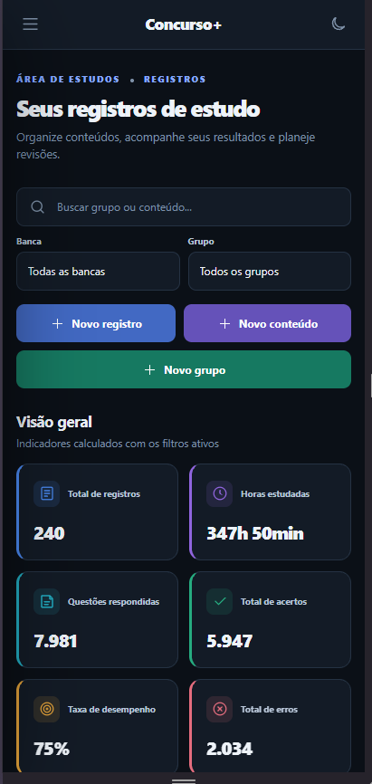](images/visao_geral_mobile.png) |


### 1.3. Organização por grupos e conteúdos

Grupos e conteúdos têm prioridades, cores e filtros próprios. O histórico pode ser expandido por assunto, com acesso a ações de criação, edição e exclusão. Além de visualização por últimos registros inseridos.

| Desktop | Mobile |
|:---:|:---:|
| [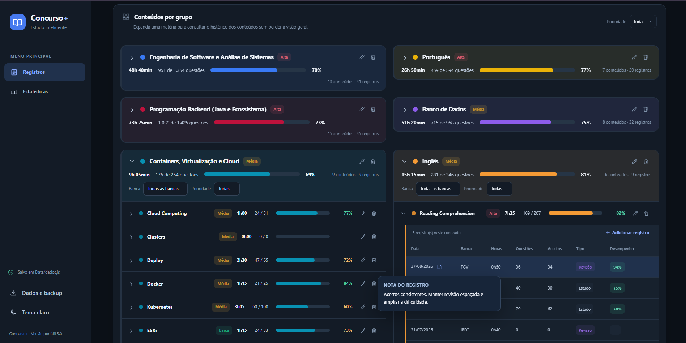](images/grupo_conteudo_desktop.png) | [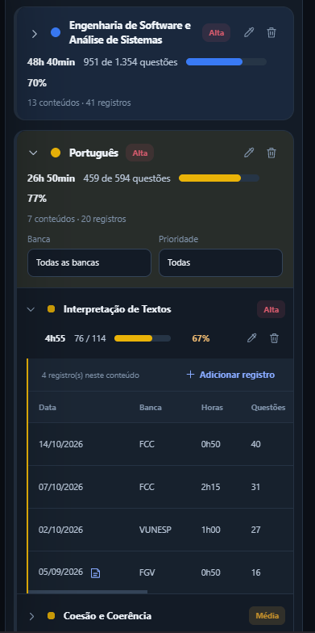](images/grupo_conteudo_mobile.png) |

### 1.4. Histórico e consulta de atividades

A listagem mostra data, banca, duração, questões, acertos e resultado por sessão. Anotações ficam acessíveis ao passar o cursor sobre o ícone ou ao focalizá-lo com o teclado.

| Desktop | Mobile |
|:---:|:---:|
| [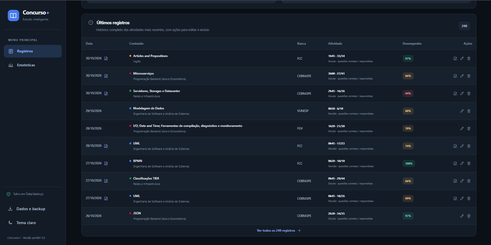](images/ultimos_registros_desktop.png) | [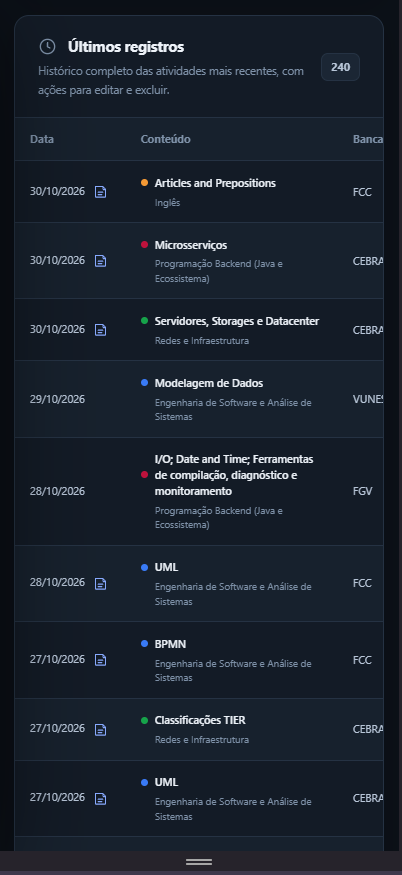](images/ultimos_registros_mobile.png) |

## 2. Estatísticas
### 2.1. Painel geral de estatísticas

Indicadores de horas, registros, questões, acertos, erros e aproveitamento são calculados a partir das sessões persistidas. Os filtros permitem restringir a análise por período, grupo e banca.

| Desktop | Mobile |
|:---:|:---:|
| [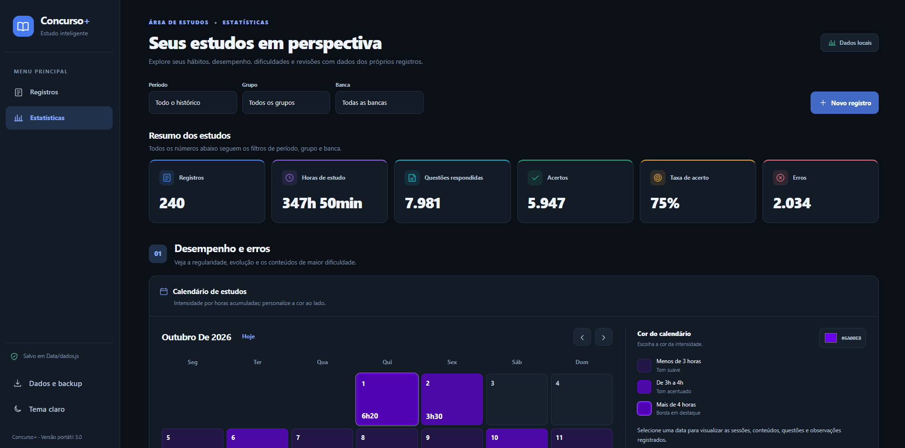](images/visao_geral_estatisticas_desktop.png) | [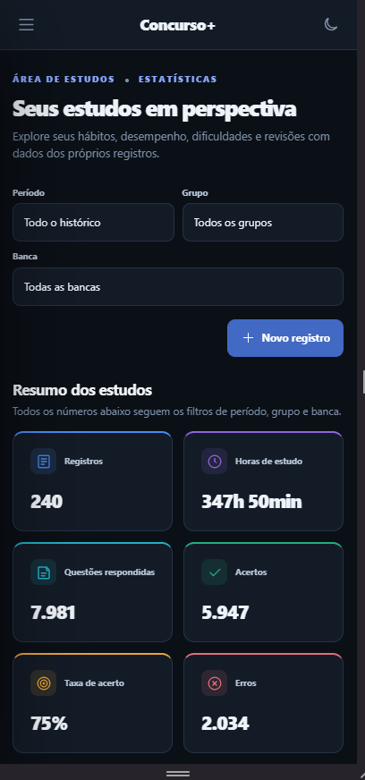](images/visao_geral_estatisticas_mobile.png) |

### 2.2. Calendário de estudos com cor personalizável

Calendário mensal interativo com escolha de cor e intensidade conforme a duração diária: menos de 3 horas em tom suave; de 3 a 4 horas em tom acentuado; acima de 4 horas com borda destacada. Ao selecionar um dia, aparecem as sessões, conteúdos, bancas, questões, acertos e observações.

| Desktop | Mobile |
|:---:|:---:|
| [](images/calendario_desktop.png) | [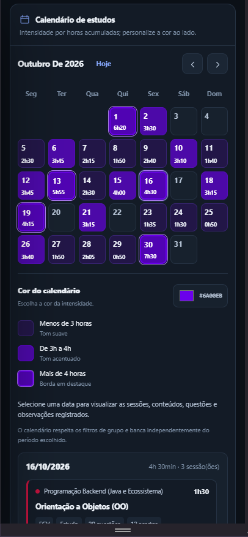](images/calendario_mobile.png) |

### 2.3. Grupos mais estudados

Rosca de distribuição do tempo entre grupos, com legenda associada às cores e aos valores de horas. O componente aparece imediatamente após o calendário.

| Desktop | Mobile |
|:---:|:---:|
| [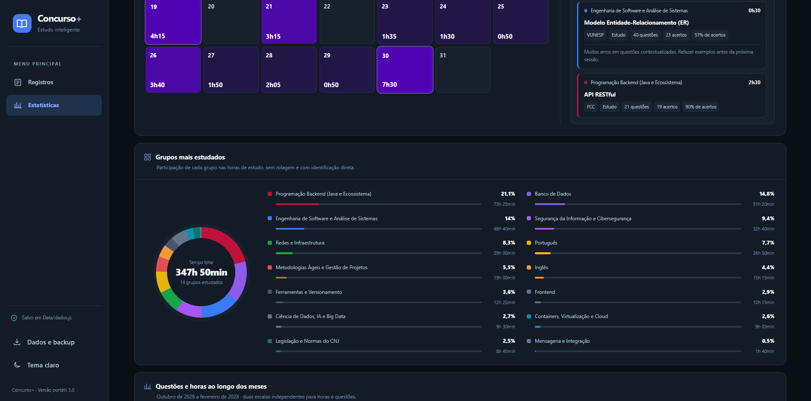](images/rosca_horas_grupo_desktop.png) | [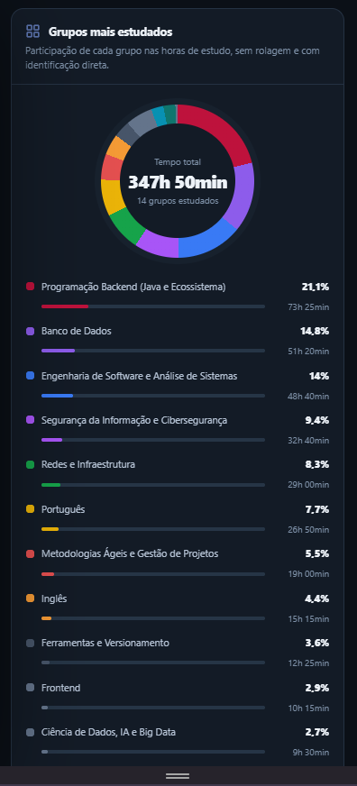](images/rosca_horas_grupo_mobile.png) |

### 2.4. Evolução mensal de horas e questões

Gráfico de linhas com duas escalas independentes: questões no eixo esquerdo e horas no direito. A janela exibida nesta versão vai de **outubro de 2026 a fevereiro de 2028**; meses sem registros são apresentados com valor zero.

| Desktop | Mobile |
|:---:|:---:|
| [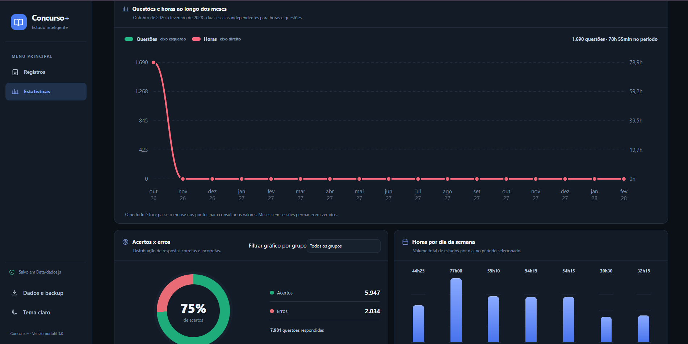](images/evolucao_mensal_desktop.png) | [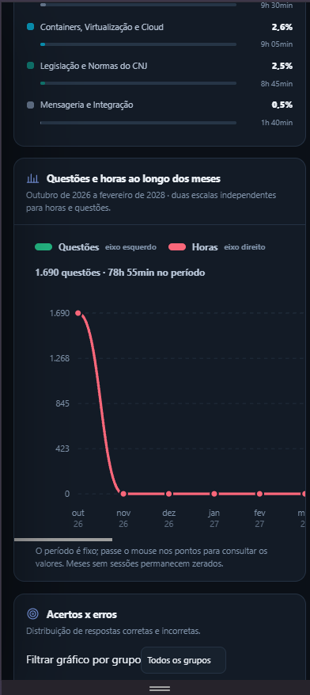](images/evolucao_mensal_mobile.png) |

### 2.5. Acertos, erros e dedicação semanal

Uma rosca resume respostas corretas e incorretas, com opção de selecionar um grupo. Ao lado, colunas verticais mostram as horas acumuladas por dia da semana, com aproveitamento do espaço em diferentes telas. Abaixo há indicadores compactos de desempenho: Os conteúdos com mais erros absolutos usam colunas compactas; as maiores taxas de erro são exibidas em escalas pontuais; os melhores e piores aproveitamentos aparecem em indicadores circulares.

| Desktop | Mobile |
|:---:|:---:|
| [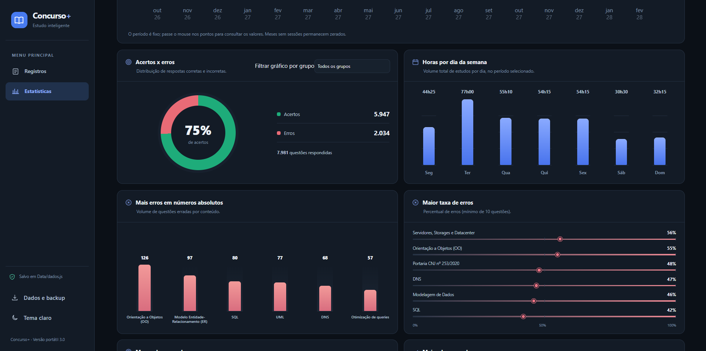](images/acertos_erros_desktop.png) | [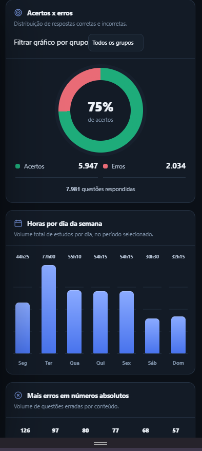](images/acertos_erros_mobile.png) |


### 2.6. Conteúdos recorrentes e pontos críticos

Um mosaico proporcional (*treemap*) destaca os seis conteúdos com maior dedicação. O painel **Muito estudo e baixo desempenho** apresenta cartões objetivos com horas e taxa de acerto para conteúdos com pelo menos 10 questões, tempo acima da mediana e aproveitamento inferior a 65%. Abaixo colunas compactas mostram as revisões por grupo; cartões destacam os conteúdos mais revisados e os menos revisitados. A prioridade de atenção é calculada como **erros ÷ (1 + revisões)**, considerando conteúdos com pelo menos 10 questões. Somente sessões registradas como revisão entram nessas estatísticas.

| Desktop | Mobile |
|:---:|:---:|
| [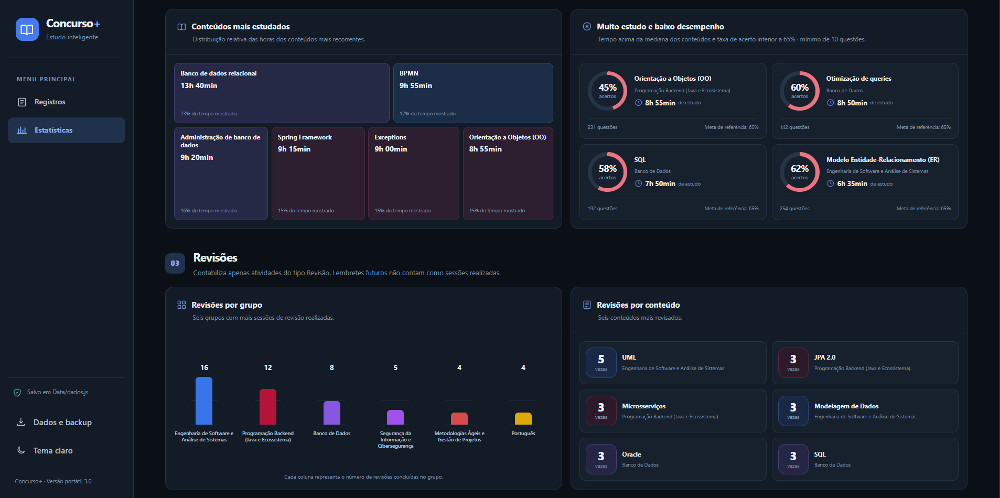](images/mosaico_desktop.png) | [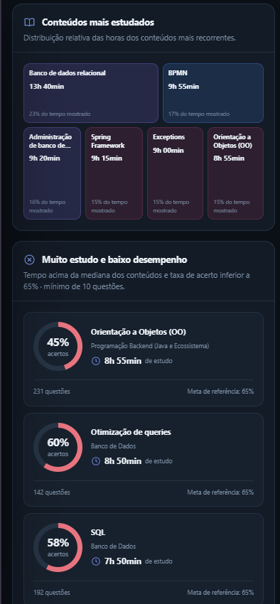](images/mosaico_mobile.png) |

### 2.7. Comparativos Top 5 por conteúdo

Os gráficos **Horas dedicadas por conteúdo** e **Desempenho por conteúdo** usam roscas com legenda e mostram apenas os cinco primeiros colocados. No primeiro, as fatias representam horas estudadas; no segundo, representam a **quantidade absoluta de acertos** dos cinco melhores por taxa, enquanto a legenda informa a taxa de acerto individual.

| Desktop | Mobile |
|:---:|:---:|
| [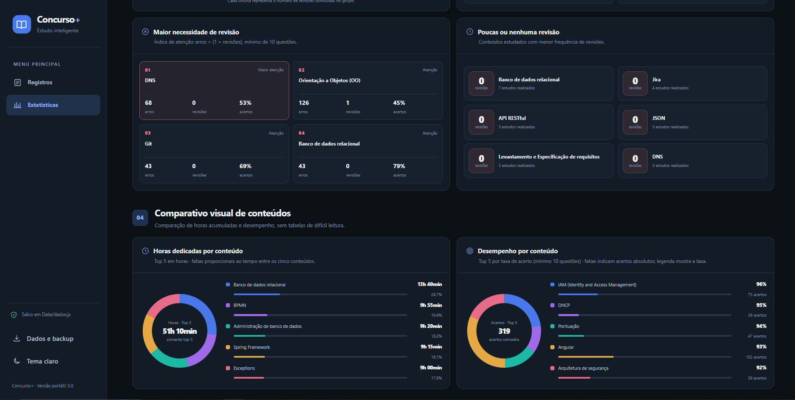](images/comparativo_desktop.png) | [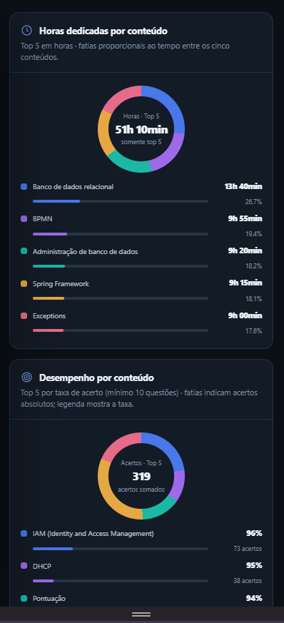](images/comparativo_mobile.png) |

## ⚙️ Funcionalidades e regras de negócio

- **Registros de estudo:** cadastro, edição, exclusão e consulta de sessões, com identificação da banca, duração, questões respondidas, acertos, anotações e distinção entre estudo e revisão.
- **Organização de conteúdos:** estrutura hierárquica de grupos e assuntos, com cores, prioridades e filtros por banca e grupo.
- **Revisões:** criação de lembretes futuros e acompanhamento das revisões realizadas, sem misturar lembretes com sessões efetivamente concluídas.
- **Indicadores de desempenho:** totais de horas, sessões, questões, acertos, erros e taxa de aproveitamento, calculados dos dados cadastrados; roscas de acertos/erros e distribuição de horas por grupo.
- **Análise de pontos fracos:** colunas compactas de erros absolutos, escalas pontuais de taxas de erro, indicadores circulares dos melhores e piores aproveitamentos e cartões para alto tempo de estudo com baixo desempenho (mínimo de 10 questões nos indicadores percentuais).
- **Calendário e evolução:** cor personalizável com escala de intensidade por duração diária, destaque dos dias acima de quatro horas e gráfico mensal de horas e questões em eixos independentes.
- **Dados e backups:** armazenamento automático local, importação/exportação JSON, cópia de segurança e migração de dados de versão anterior.
- **Comparativos e revisões:** treemap de conteúdos estudados, painéis compactos de revisões realizadas, índice de atenção por erros ÷ (1 + revisões) e gráficos de rosca Top 5 de horas e acertos.
- **Aparência:** temas claro e escuro, interface responsiva em desktop e mobile e anotações acessíveis por hover e foco do teclado.

## 🛠️ Tecnologias e arquitetura

**Frontend** — HTML5, CSS3 e JavaScript (vanilla), sem frameworks de interface. Componentes, tabelas, interações, gráficos e calendário são construídos com recursos nativos da aplicação, incluindo o estilo específico da página de estatísticas em `Style/estatisticas-redesign.css`.

**Servidor local** — Node.js 18+ com os módulos nativos `http`, `fs`, `path` e `crypto`. O backend disponibiliza as páginas e uma API local (`GET /api/data` e `PUT /api/data`) para leitura e atualização do arquivo de dados. **Não são necessárias dependências npm de terceiros.**

**Persistência** — arquivo `Data/dados.js` gravado automaticamente na pasta do projeto. As atualizações passam por validações e escrita em arquivo temporário antes da substituição; a versão anterior é copiada para `Data/dados-anteriores.js`. O controle de revisão evita sobrescritas silenciosas entre abas desatualizadas.

> **Importante:** armazenamento local não significa autenticação, criptografia ou isolamento entre contas no mesmo computador. Pessoas com acesso à pasta podem ler os arquivos. O aplicativo foi desenvolvido para uso local e individual; **não exponha o servidor à internet**.

## 🚀 Como executar o projeto localmente

### Pré-requisitos

- **Node.js 18 ou superior**.
- Terminal ou prompt de comando.
- Navegador moderno.

### 1. Clonar o repositório

```bash
git clone https://github.com/pedrot00/concurso-plus.git
cd concurso-plus
```

> O link acima passa a funcionar quando este repositório for publicado com esse nome. Execute os comandos na pasta que contém `package.json` e `server.js`.

### 2. Criar seu arquivo de dados local

O repositório distribui somente um **arquivo de exemplo com dados fictícios**. Para criar seu armazenamento particular, copie-o para `Data/dados.js`.

**Windows (PowerShell):**

```powershell
Copy-Item Data\dados.example.js Data\dados.js
```

**Linux e macOS:**

```bash
cp Data/dados.example.js Data/dados.js
```

Em seguida, você poderá modificar ou limpar os registros de demonstração pelo aplicativo. O arquivo `Data/dados.js` está no `.gitignore` e **não deve ser versionado**.

### 3. Iniciar o aplicativo

```bash
npm start
```

No Windows, também é possível executar o arquivo `iniciar.bat`.

Abra no navegador:

**http://127.0.0.1:3100**

O servidor utiliza somente a interface local `127.0.0.1`. Mantenha o processo aberto durante o uso. Não é necessário executar `npm install`, pois o projeto não utiliza pacotes de terceiros.

## 💾 Armazenamento, privacidade e backups

O Concurso+ **salva automaticamente** as alterações em `Data/dados.js`, preservando grupos, conteúdos, sessões, revisões e preferência de tema entre acessos. Não há dependência de banco de dados remoto nesta versão.

Cada instalação possui seu próprio conjunto de dados. Isso evita misturar informações entre **cópias distintas** do aplicativo, mas a privacidade de cada arquivo depende das permissões de acesso do computador e da pasta. O sistema atualmente **não possui autenticação por usuário**.

Para se proteger contra perda de arquivos, a aplicação oferece três mecanismos: cópia local da versão anterior (`Data/dados-anteriores.js`), exportação manual de backups JSON e importação de dados. Recomenda-se manter cópias dos backups fora da pasta do projeto.

**Atenção ao GitHub:** nunca publique arquivos pessoais `Data/dados.js`, `Data/dados-anteriores.js` ou backups de uso real. Se esses arquivos já tiverem sido rastreados pelo Git, adicioná-los ao `.gitignore` não remove o histórico anterior.

## 🗂️ Estrutura do projeto

```text
concurso-plus/
├── Data/
│   ├── dados.example.js       # Dados demonstrativos versionáveis
│   ├── dados.js               # Dados pessoais locais (ignorado pelo Git)
│   └── dados-anteriores.js    # Backup local automático (ignorado pelo Git)
├── Pages/
│   ├── registros.html
│   └── estatisticas.html
├── Scripts/
│   ├── store.js               # Estado, validação e persistência
│   ├── utils.js               # Funções utilitárias
│   ├── ui.js                  # Layout e interações compartilhadas
│   ├── registros.js
│   └── estatisticas.js
├── Style/
│   ├── base.css
│   ├── registros.css
│   ├── estatisticas.css
│   ├── estatisticas-redesign.css # Gráficos e layout atualizados
│   └── polish.css
├── docs/
│   └── screenshots/           # Capturas desktop e mobile
├── tests/                     # Testes automatizados
├── index.html
├── iniciar.bat                # Inicialização no Windows
├── server.js                  # Servidor e API local
├── package.json
├── .gitignore
└── README.md
```

## ✅ Testes

Na raiz do projeto, execute:

```bash
npm test
```

O comando executa os testes automatizados do servidor, da persistência e da renderização usando o test runner nativo do Node.js.

## 🧭 Próximas evoluções

O desenvolvimento do Concurso+ partiu das necessidades levantadas com estudantes e continuará orientado por melhorias de usabilidade e organização da rotina. Possíveis próximos passos:

- Introduzir uma opção de persistência estruturada e/ou sincronização de dados, preservando a proposta de privacidade e controle do usuário.
- Permitir maior personalização dos períodos e das visualizações estatísticas.
- Ampliar os recursos de planejamento e acompanhamento de revisões.
- Evoluir a experiência de uso com base em novos feedbacks de estudantes.

*Esses itens são possibilidades futuras e não representam funcionalidades já implementadas.*

## 👨‍💻 Autor

**Pedro S. Teixeira** — [GitHub](https://github.com/pedrot00)

Se o projeto for útil para sua rotina de estudos, considere deixar uma estrela no repositório.
